# Hi there, I'm Dhanya  👋 
### Computer Science & Engineering Student | Backend Devloper

---

### 🚀 About Me

I am a Computer Science Engineering student passionate about developing reliable, scalable backend systems, secure automation tools, and Agentic AI applications. I enjoy participating in fast-paced hackathons and solving challenging data workflows.

- 🎓 **Education:** Pursuing a B.E. in Computer Science Engineering at Vidyavardhaka College of Engineering (Class of 2027)
- 🔭 **Recent Projects:** Built **PR Guardian** (an IaC security bot) and an **Agentic AI Customer Support Routing System**
- 🌱 **Learning Focus:** Deepening my knowledge in DevOps pipelines, CI/CD security, and Cloud Engineering
- 💬 **Ask me about:** Java, Node.js, Express, Flask, RAG workflows, or Vector DBs

---

### 🛠️ Tech Stack & Tools

#### ⚙️ Languages & Core Backend
     

#### 🤖 AI Engineering & Databases
   

#### 🔧 Tools, Cloud & DevOps
     

---

### 🏆 Hackathons & Highlights

* 🏆 **3rd Place | Cloud Hackathon:** Developed a cloud security configuration detector for CI/CD environments.
* 🚀 **Finalist | SuPrathon 2K25:** Placed in the top 75 out of 400+ teams with a full-stack product.
* 🏥 **Finalist | Hack-Kshetra 2.0:** Devised an automated hospital triage system for medical prioritization.

---

### 📊 GitHub Analytics

```mermaid
gantt
    title Core Domains & Expertise
    dateFormat  X
    axisFormat %
    section Backend Systems
    Java/Node.js/SQL : active, 0, 90
    section GenAI Development
    LLMs/RAG/ChromaDB : active, 0, 85
    section DevOps & Cloud
    Docker/GCP/CI-CD : active, 0, 75
```

---

